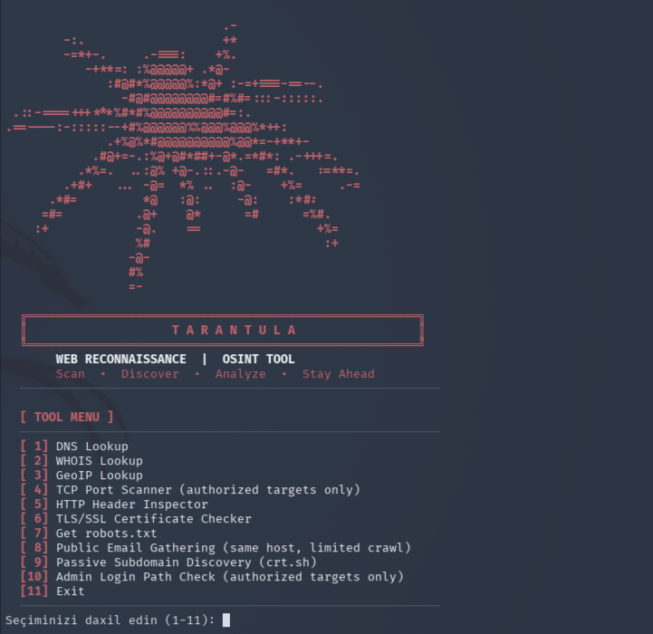

# TARANTULA 🕷️

**A Python-based reconnaissance toolkit for the information-gathering phase of authorized security assessments.**

TARANTULA is a command-line tool I built to learn cybersecurity fundamentals. It automates common reconnaissance tasks such as DNS and WHOIS lookups, passive subdomain discovery, port checks, HTTP header analysis, and TLS inspection.

> **For authorized testing only.** Use it only on systems you own or have explicit written permission to assess.

  

## Features

| #  | Module | Description |
|----|--------|-------------|
| 1  | **DNS Lookup** | Retrieve common DNS records (A, AAAA, MX, NS, TXT, CNAME). |
| 2  | **WHOIS Lookup** | Retrieve domain registration information. |
| 3  | **GeoIP Lookup** | View approximate network/hosting location of an IP address. |
| 4  | **TCP Port Scanner** | Check a limited list of common TCP ports (asks for authorization confirmation). |
| 5  | **HTTP Header Inspector** | Inspect HTTP response headers and redirects. |
| 6  | **TLS/SSL Certificate Checker** | Validate the certificate chain and show expiry, issuer, and TLS version. |
| 7  | **robots.txt Viewer** | Retrieve a website's `robots.txt` file. |
| 8  | **Public Email Gathering** | Find publicly visible email addresses (same host, limited crawl). |
| 9  | **Passive Subdomain Discovery** | Search public Certificate Transparency logs via crt.sh. |
| 10 | **Admin Login Path Check** | Check common login paths with ordinary GET requests (asks for authorization confirmation). |
| 11 | **Exit** | Close the application. |

## Requirements

- Python 3.10 or newer
- Internet connection
- Dependencies listed in `requirements.txt`

## Installation

```bash
git clone https://github.com/NijatEthical/Tarantula.git
cd Tarantula
python3 -m venv venv
source venv/bin/activate
python3 -m pip install -r requirements.txt
```

## Usage

```bash
python3 Tarantula.py
```

Choose an option from the interactive terminal menu and follow the prompts.

## Responsible Use

TARANTULA is intended for educational purposes and authorized security assessments.

- Only test systems you own or have explicit permission to assess.
- Respect hosting-provider policies and applicable laws.
- Do not use this tool for unauthorized scanning or data collection.
- GeoIP results are approximate and do not identify a person's exact location.
- A publicly accessible login page is not automatically a security vulnerability.

## Limitations

This project provides basic reconnaissance features only. Results may be incomplete or affected by network restrictions, DNS configuration, rate limits, and hosting-provider policies. It only sends ordinary requests: it does not exploit vulnerabilities, attempt logins, or test passwords.

It is an educational project, not a replacement for professional tools (such as Nmap) or a professional security assessment.

## Technologies

- Python
- Requests
- dnspython
- python-whois

## Disclaimer

The author is not responsible for misuse of this software. Users are responsible for ensuring that their activities comply with applicable laws and authorization requirements.

## Author

**Nijat** — [GitHub: NijatEthical](https://github.com/NijatEthical)
**Category:** Cybersecurity / Python / Reconnaissance
